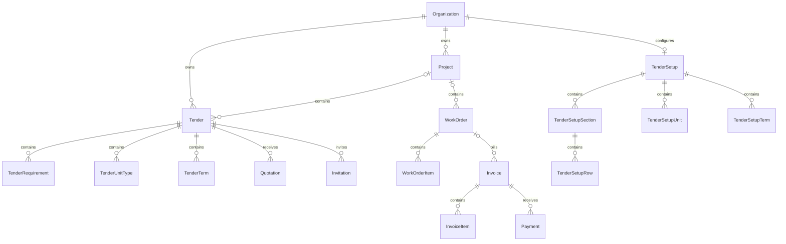

# Backend structure and database guide

The backend keeps the existing frontend API contract while storing each business entity in its own PostgreSQL table. The frontend design and source files were not changed for this refactor.

## Folder structure

```text
backend/
  src/
    app.ts                    Express setup and middleware
    server.ts                 Startup and shutdown
    config/                   Database connection, origins and cookie settings
    routes/                   URL definitions and role requirements
    controllers/              Read requests and send responses
    services/                 Business rules and transaction boundaries
    repositories/             Table access and API/database field mapping
    validators/               Zod request schemas
    middleware/               Authentication, errors, origins, uploads and limits
    utils/                    Money, HTML sanitization, hashing and HTTP helpers
    constants/                Module names and permitted statuses
    types/                    Shared authenticated-user types
    generated/prisma/         Generated client; do not edit
  prisma/
    schema.prisma             Tables, columns, indexes and relationships
    migrations/               Versioned SQL changes, including data conversion
    seed.ts                   Initial owner and optional demo records
  scripts/
    import-reference.ts       Additive legacy reference import
    import-parity.ts          Tender Form and rich template import
    migrations/               One-time normalization verification utilities
  test/
    integration.test.ts       API and database regression checks
```

A request flows through **route → controller → service → repository/Prisma**. Controllers handle HTTP details. Services own permissions that depend on the module, business checks, transactions and audit entries. Repositories handle database queries and convert the normalized columns into the response shape the frontend already expects.

The common CRUD endpoints share `record.controller.ts` and `record.service.ts`. This avoids duplicating identical listing, versioning, archive and comment behavior across fourteen modules. Tender awards, public submissions, payment recording, projects, accounts, files and Tender Form setup have separate services.

## Business tables

| Existing API module | PostgreSQL / Prisma model | Related child tables                                      |
| ------------------- | ------------------------- | --------------------------------------------------------- |
| tenders             | Tender                    | TenderRequirement, TenderUnitType, TenderTerm, Invitation |
| quotes              | Quotation                 | Direct `tenderId` foreign key                             |
| work-orders         | WorkOrder                 | WorkOrderItem                                             |
| invoices            | Invoice                   | InvoiceItem, Payment; optional `workOrderId`              |
| permissions         | Permission                | Project and assignee foreign keys                         |
| tasks               | Task                      | Project and assignee foreign keys                         |
| topics              | Topic                     | TopicMember                                               |
| documents           | Document                  | Attachments through Entity                                |
| templates           | Template                  | TemplateRequirement; attachments through Entity           |
| feasibility         | Feasibility               | Project and attachment relationships                      |
| meetings            | Meeting                   | Project and assignee foreign keys                         |
| progress            | ProgressUpdate            | Project and assignee foreign keys                         |
| developers          | Developer                 | Typed contact columns                                     |
| schemes             | PermissionScheme          | Typed scheme/stage/checklist columns                      |

The standalone Tender Form uses `TenderSetup`, `TenderSetupUnit`, `TenderSetupTerm`, `TenderSetupSection` and `TenderSetupRow`. It is separate from project-specific Tender rows and from Template records.

Company details use `OrganizationProfile`. Project contacts use `ProjectCoordinator`. Ordered lists have an explicit `position` column, so reloading preserves their display order. Catalog `sortOrder` remains a separate original business field.



### Shared identity and relationships

`Entity` is a small registry containing only `id`, `organizationId` and `kind`. It lets files and comments point to any supported entity through a real foreign key. It does not contain titles, business fields, money, timestamps or JSON payloads. Those live in the dedicated business tables. The old generic `Record` table is removed, and there are no JSON/JSONB columns in the application schema.

Every business row has its own typed columns and preserves the common fields: title, reference, status, assignment, priority, dates, content, money, archive flag, version, `createdAt` and `updatedAt`. Composite foreign keys prevent connecting a row to another organization's project or assignee. The registry composite key and SQL kind checks prevent attaching an identity to the wrong entity table.

Quotations reference Tender directly. Invoices reference WorkOrder directly when supplied. Payments can only reference Invoice. A partial unique index permits at most one active accepted quotation per tender. Common `(organizationId, reference)` uniqueness is enforced separately in each business table.

Original free-text developer names, topic labels, member names and attendee text remain as stored. They are not guessed into user/developer relationships: those values can be historical labels or people who have no account. Stable project, organization, assignee, tender, work-order, invoice and attachment relationships are enforced by foreign keys.

## API compatibility

The existing URLs remain valid, for example:

```text
GET  /api/records/tenders
POST /api/records/tenders
PUT  /api/records/tenders/:id       If-Match: <version>
POST /api/tenders/:id/invitations
POST /api/quotes/:id/award
POST /api/records/invoices/:id/payments
GET  /api/tender-setup
PUT  /api/tender-setup              If-Match: <version>
```

Responses still contain `data`, `parentId`, `files`, `comments` and `payments` because existing frontend components use them. `data` is assembled from typed columns and child rows in `repositories/entity.repository.ts`; it is **not** a database JSON column. `parentId` maps to `Quotation.tenderId` or `Invoice.workOrderId`. File/comment `recordId` aliases map to `entityId`, and payment `recordId` maps to `invoiceId`.

- `repositories/entity-map.ts` lists each module's table, scalar fields and child tables.
- `validators/record.schema.ts` defines each module's accepted input fields.
- `services/payment.service.ts` locks the invoice and uses decimal arithmetic before recording a receipt.
- `services/tender.service.ts` serializes awards against their tender and rejects replayed submissions.
- Edits use optimistic versions; a rejected stale save cannot partially update child rows.
- Money totals retain `Decimal(18,2)`. Detailed numeric inputs use decimal columns and are converted to the existing numeric API representation.

For example, direct database queries are now readable:

```ts
const tenders = await db.tender.findMany({
  where: { organizationId, archived: false },
  include: {
    requirements: { orderBy: { position: "asc" } },
    unitTypes: { orderBy: { position: "asc" } },
    quotations: true,
  },
});
```

Use the service/repository creation functions when writing through the API; they create the identity and business row in one transaction.

## Migration and verification

Migration `202610290001_normalized_entities` is an atomic data conversion. It locks the affected tables, checks for unrecognized fields, creates the normalized schema, copies data, checks row counts and original values, then retires the old tables. Any error rolls the transaction back. Run migrations during a maintenance window with API writers stopped. Do not use `prisma migrate reset` or `db push` on an existing workspace.

The local database was migrated after rehearsal on an isolated copy. All **382 existing business records** were compared against the snapshot, including IDs, values, content, original timestamps, versions and archive state. Payments, file bytes, comments, invitations, sessions, users, projects, profile and Tender Form data were also checked. No existing data was re-seeded.

Original timestamp columns were copied exactly. New child rows inherit their original parent's timestamps. Tables that did not previously have `updatedAt` receive an initial value from their existing creation timestamp; TenderSetup's new `createdAt` uses its previously available `updatedAt`. This avoids inventing earlier history.

The local pre-migration snapshot is in `backend/.local/backups/before-relational-refactor.json`. It includes private database content and is excluded from Git, Docker context and source ZIPs. Keep it private. The one-time scripts in `scripts/migrations/` can rebuild a separate database from this snapshot for inspection; they never restore over the active database. For production, take and verify a normal PostgreSQL backup before deploying the migration and release the new API together with it. The old API cannot run against the normalized schema.

Fresh installation was also checked through all four migrations, seeding, and repeated reference imports. The complete 24-test regression suite passes, including database-level foreign keys, normalized child rows, edit conflicts, tenant isolation, payment races and tender awards.

```sh
# From the project root
npm run db:migrate
npm run build
npm test
```

`APP_URL` remains the main frontend origin. Optional `ALLOWED_ORIGINS` is a comma-separated list of additional trusted browser origins, replacing a hardcoded origin exception. No credentials are stored in source.

## Adding or changing a field

1. Add the typed column or child relationship to `prisma/schema.prisma` and create a new migration. Do not edit an already-applied migration.
2. Update its Zod validation and the explicit mapping in `repositories/entity-map.ts`.
3. Add business behavior in the relevant service; keep HTTP handling in the controller.
4. Keep the response contract compatible, or change the frontend API handling deliberately.
5. Run the regression suite and build, and test migration against a backup copy before deployment.
